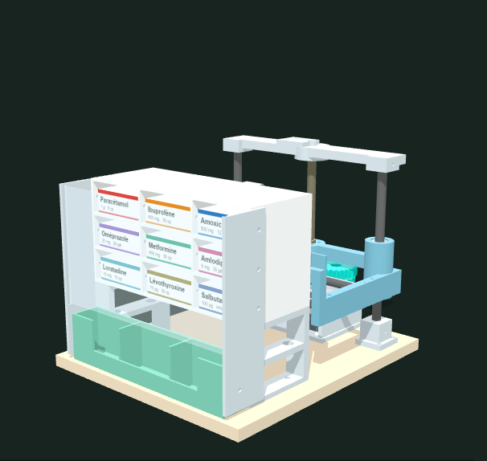
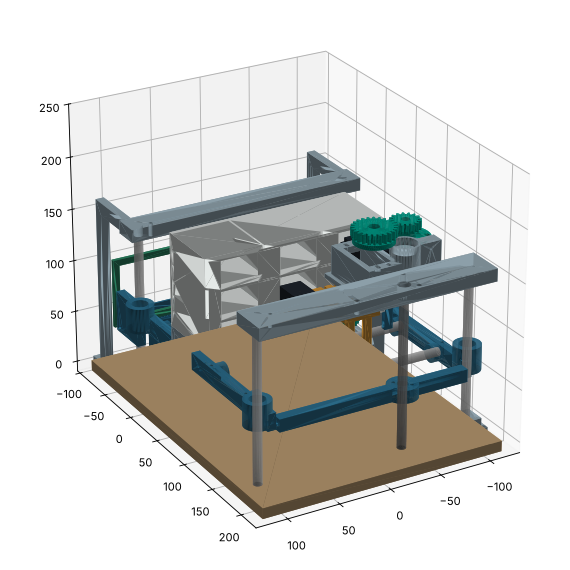
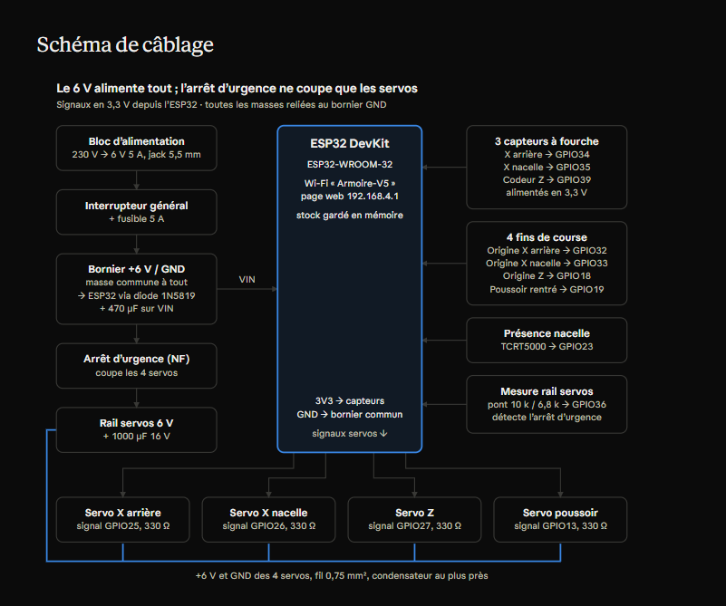

# Armoire de stockage robotisée pour pharmacie (V5)

Armoire automatique de 9 cases (3 × 3) qui distribue des boîtes de médicaments de 50 × 60 × 20 mm.
On choisit la case sur son téléphone, la machine va chercher la boîte et l'amène dans une trappe en bas à droite.

**Voir le prototype en 3D dans le navigateur : https://armoireauto.netlify.app/**




## Principe

- **Cadre Z** (ascenseur) monté sur 4 tiges Ø8 et une vis trapézoïdale T8, entraînée par un servo et deux engrenages.
- Sur le cadre Z, deux chariots X qui se déplacent ensemble (un servo chacun) :
  - à l'avant, la **nacelle** qui reçoit la boîte ;
  - à l'arrière, le **poussoir** (crémaillère) qui fait glisser la boîte de sa case vers la nacelle.
- La nacelle redescend ensuite jusqu'à la **trappe**, en bas à droite.
- Positions repérées par des **capteurs à fourche** : un peigne par chariot X, un disque codeur de 8 fentes sur la vis T8 (0,5 mm par front).
- 4 servos Parallax 900-00008 à rotation continue, pilotés par un **ESP32** qui sert aussi une page web.

Encombrement : environ 236 × 315 mm au sol.

## Contenu du dépôt

| Dossier | Contenu |
| --- | --- |
| `cao/` | Modèle paramétrique en Python ([CadQuery](https://github.com/CadQuery/cadquery)) et scripts d'export |
| `step/` | Assemblage complet au format STEP |
| `impression/stl_ultimaker2/` | Pièces découpées pour un plateau de 223 × 223 mm (Ultimaker 2 Extended+) |
| `impression/stl_bambulab_a1mini/` | Pièces découpées pour un plateau de 180 × 180 mm (Bambu Lab A1 mini) |
| `impression/plateaux_bambulab_a1mini/` | Plateaux `.3mf` prêts à trancher dans Bambu Studio |
| `electronique/armoire_v5/` | Programme ESP32 (Arduino) : mouvements, stock, page web |
| `docs/` | Visionneuse 3D (`visionneuse_3D.html`, en ligne sur [armoireauto.netlify.app](https://armoireauto.netlify.app/)), nomenclature d'impression, liste d'achats |

Les fichiers G-code ne sont pas dans le dépôt : ils dépendent de l'imprimante et se régénèrent à partir des STL.

## Impression

- PLA, buse 0,4 mm, couches de 0,2 mm.
- Casier : 3 parois, 15 % de remplissage. Pièces longues : 3 parois, 25 %. Pièces mécaniques (engrenages, paliers, chariots) : 4 parois, 40 %.
- Bambu Lab A1 mini : ouvrir chaque `.3mf` du dossier `plateaux_bambulab_a1mini`, **trancher** dans Bambu Studio, puis imprimer. Chaque plateau s'imprime une fois.
- Commencer par le plateau d'essai des pignons pour vérifier le jeu des engrenages.

## Électronique



| Élément | Choix |
| --- | --- |
| Carte | ESP32-WROOM-32 DevKit |
| Alimentation | bloc 6 V 5 A ; arrêt d'urgence sur le rail des servos uniquement |
| Actionneurs | 4 servos Parallax 900-00008 (X arrière, X nacelle, Z, poussoir) |
| Capteurs | 3 fourches optiques LM393, 4 fins de course, 1 TCRT5000 dans la nacelle |
| Interface | Wi-Fi « Armoire-V5 » créé par l'ESP32, page sur http://192.168.4.1 |

Brochage complet dans [`electronique/armoire_v5/config.h`](electronique/armoire_v5/config.h).

### Installer le programme

1. IDE Arduino 2, carte « esp32 » by Espressif Systems.
2. Bibliothèque **ESP32Servo** (Kevin Harrington).
3. Ouvrir `electronique/armoire_v5/armoire_v5.ino`, carte « ESP32 Dev Module », téléverser.
4. Téléphone sur le Wi-Fi `Armoire-V5`, ouvrir http://192.168.4.1.

## Régénérer les pièces

```bash
pip install cadquery trimesh
cd cao
python export5.py ../sortie_ultimaker      # pièces pour plateau 223 mm
python export5_a1.py ../sortie_a1mini      # pièces pour plateau 180 mm
```

Les cotes principales (casier, entraxes, course du poussoir...) sont des constantes en tête de `cad5.py`.

## État du projet

- [x] Conception mécanique V5 et vérification des collisions
- [x] Fichiers d'impression (Ultimaker 2 Extended+ et Bambu Lab A1 mini)
- [x] Schéma électrique et programme ESP32
- [ ] Impression et assemblage
- [ ] Mise en service et réglages
