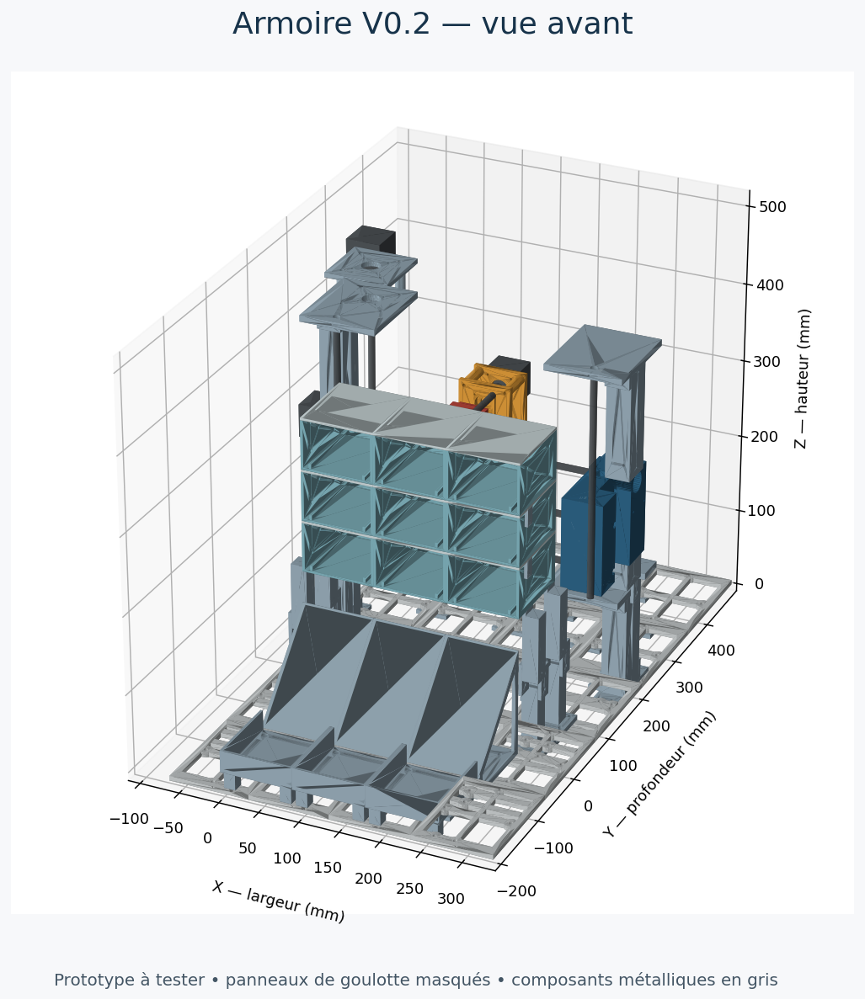

# Armoire robotisée — prototype étudiant

Une maquette d’armoire de stockage automatisée : sélectionner une case, positionner un robot derrière celle-ci et pousser une boîte vers la zone de récupération.

**Version mécanique V0.2 — prototype non construit, essais physiques à réaliser.** Les fichiers sont une base de développement pour un projet étudiant, pas un dispositif de distribution de médicaments validé. Utiliser des boîtes factices pour les essais.



## Principe

- Une armoire de **9 cases (3 × 3)** reçoit les boîtes.
- Deux axes positionnent le chariot : **X horizontal et Z vertical**.
- Un troisième axe **Y** actionne le poussoir.
- Une goulotte et des bacs récupèrent les boîtes à l’avant.

La structure est imprimable par éléments sur une **Bambu Lab A1 mini**. Le mécanisme est hybride : pièces imprimées, guidages métalliques, vis M8 et moteurs achetés séparément.

## Caractéristiques de cette version

| Élément | Définition |
|---|---|
| Cases assemblées | Pas de 90 × 100 × 65 mm ; bloc de 270 × 100 × 195 mm |
| Boîtes factices prévues | 60 mm de largeur × 80 mm de profondeur × 35 mm de hauteur |
| Socle | 400 × 700 mm, assemblé à partir de 20 tuiles |
| Encombrement approximatif | 443 × 700 × 519 mm, moteurs compris |
| Poussoir | Course nominale de 115 mm |
| Guidages / transmission | Tiges Ø8 mm / vis M8 au pas de 1,25 mm |
| Motorisation de référence | 3 moteurs NEMA 17 ; dimensions détaillées dans la nomenclature |
| Impression | 67 références STL ; 213 exemplaires selon la nomenclature, accessoires et coupons compris |
| CAO | Source CadQuery et assemblage STEP ouvrable dans Fusion |

## Commencer

1. Lire [les précautions avant impression](LIRE_AVANT_IMPRESSION.md) et le [guide de montage](Documentation/guide_montage.md).
2. Ouvrir `CAO/assemblage_Fusion.step` dans Fusion pour inspecter l’assemblage. Il s’agit d’un import STEP, sans historique paramétrique natif Fusion.
3. Vérifier les dimensions des composants réellement disponibles à l’aide de la [liste des achats](Documentation/composants_a_acheter.csv).
4. Imprimer d’abord les coupons **41 / 42**, puis une case **01** et son couvercle **02**. Ajuster les jeux si nécessaire.
5. Utiliser la [nomenclature d’impression](Documentation/nomenclature_impression.csv) pour les quantités et orientations. Les STL sont en **millimètres**.

**Ne pas lancer toutes les pièces avant les premiers essais d’ajustement.** La compatibilité avec le volume d’impression ne garantit pas un tranchage sans supports ni une impression réussie.

## Fichiers

| Dossier | Contenu |
|---|---|
| `STL/` | Une référence par fichier, à multiplier selon la nomenclature |
| `CAO/` | Générateur Python CadQuery et assemblage STEP |
| `Documentation/` | Montage, achats, quantités, vues et rapports géométriques |
| `tools/` | Contrôle reproductible des fichiers livrés |
| `.github/` | Vérification automatique et modèle de signalement |

## Vérifications et limites

Les rapports de la V0.2 indiquent 67 maillages fermés, 222 solides STEP réimportés valides et 10 positions contrôlées sans intersection entre pièces imprimées. Ce sont des **contrôles géométriques ponctuels** : ils ne constituent pas une validation continue du mouvement, des efforts, du couple moteur, de la rigidité, de la chute des boîtes ou de la visserie réelle.

Le contrôle automatique du dépôt vérifie les STL binaires, leurs arêtes, les dimensions et la cohérence de la nomenclature. Il ne refait pas les contrôles de mouvement. Les rapports archivés concernent la conception V0.2 livrée ; ils doivent être renouvelés après toute modification géométrique.

**Aucun firmware, schéma de câblage validé ni interface de commande fonctionnelle n’est inclus.** Ces étapes figurent dans la [feuille de route](ROADMAP.md).

## Vérifier / régénérer

Le contrôle des fichiers ne nécessite que Python 3.12 :

```sh
python tools/check_release.py
```

Pour régénérer la géométrie, dans une copie de travail avec Python 3.12 :

```sh
python -m venv .venv
# Activer .venv selon votre système, puis :
python -m pip install -r requirements.txt
python CAO/generer.py
python tools/check_release.py
```

La régénération remplace les STL, la nomenclature et le STEP. Elle ne renouvelle pas les images ni les rapports de mouvement. Conserver une copie des fichiers livrés et inspecter les changements avant de les publier.

## Participer et publier

Voir [CONTRIBUTING.md](CONTRIBUTING.md) pour documenter les essais et [le guide de publication GitHub](Documentation/PUBLIER_SUR_GITHUB.md) pour mettre ce dossier en ligne.

La conception et la documentation ont été préparées avec une assistance IA. Les choix mécaniques doivent être examinés et validés par l’équipe du projet.

## Licence

Aucune licence de réutilisation n’est définie dans cette version. L’équipe doit choisir une licence et préciser les auteurs avant de présenter le projet comme open source. Aucun fichier `LICENSE` n’a été ajouté automatiquement.
